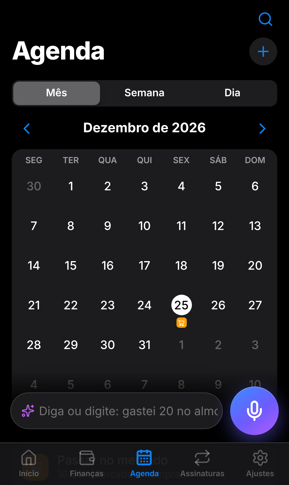
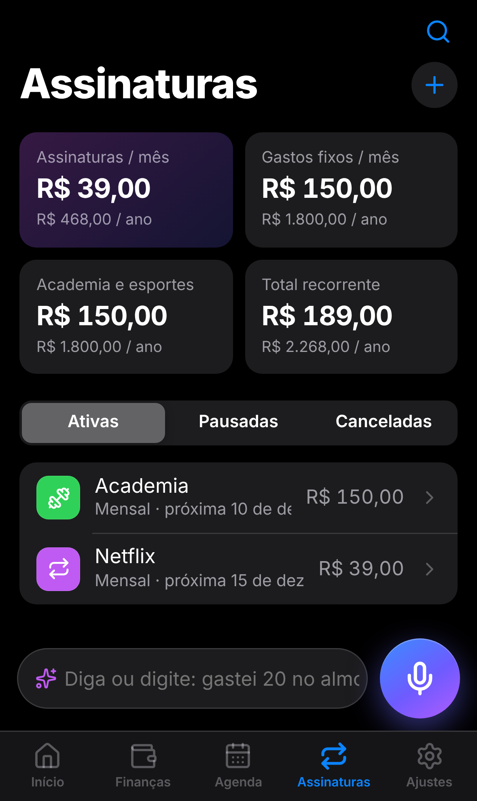

# Meu Assistente — Finanças e Agenda Inteligente

Um app pessoal para o iPhone (e o computador) em que você **segura o microfone, fala** e a despesa, a assinatura ou o compromisso é salvo no lugar certo.

## 📱 Instalar no iPhone (grátis)

1. Abra **https://darkzin-22.github.io/meu-assistente/** no **Safari**.
2. Toque em **Compartilhar › Adicionar à Tela de Início**.
3. Abra pelo ícone e diga seu nome.

Esta é a **versão local**: roda inteira no iPhone, sem servidor e sem custo. Os dados ficam só no aparelho (faça backups em Ajustes). Os lembretes funcionam pelo **Calendário do iPhone**: ao criar um compromisso, toque em **Adicionar ao Calendário** para ativar os 4 alarmes.

## 🎙️ Jarvis (pela Siri, sem abrir o app)

Diga **"E aí Siri, Jarvis"** e fale: registra despesas e entradas, informa saldo e quanto sobrou, cuida da agenda e responde perguntas gerais (IA da Apple). Precisa da versão com servidor, que dá para hospedar de graça na Oracle Cloud:

1. **[docs/ORACLE.md](docs/ORACLE.md)** — criar o servidor gratuito (instalação automática).
2. **[docs/JARVIS.md](docs/JARVIS.md)** — criar o atalho "Jarvis" na Siri.

Existem duas versões do mesmo código:

| | Versão local (GitHub Pages) | Versão com servidor (Fly.io etc.) |
|---|---|---|
| Custo | **Grátis** | ≈ US$ 2–4/mês |
| Onde ficam os dados | No iPhone | No servidor (sincroniza iPhone e computador) |
| Lembretes | Alarmes do Calendário do iPhone (1 toque por compromisso) | Notificações automáticas do app |
| Jarvis (Siri) | — | ✅ |
| Hospedagem | GitHub Pages | Oracle Cloud Always Free (grátis) ou Fly.io |
| Interpretação | Local em português | Local ou IA Claude |
| Exportação | CSV e backup | CSV, Excel e backup |

| Início | Voz → resultado | Agenda | Assinaturas |
|---|---|---|---|
|  |  |  |  |

---

## 1. Arquitetura escolhida

**PWA (app web instalável na Tela de Início) + servidor próprio pequeno em Node.js + banco SQLite.**

```
iPhone / computador (PWA React)          Servidor (Node.js + Fastify)              Serviços externos (opcionais)
┌──────────────────────────────┐   HTTPS  ┌─────────────────────────────────┐
│ Microfone (segurar e falar)  │ ───────► │ /api/transcribe ───────────────────────► Whisper (Groq ou OpenAI)
│ Campo de texto               │          │ /api/command                    │
│ Telas: Início, Finanças,     │          │   1. IA interpreta  ───────────────────► Claude (Anthropic)
│ Agenda, Assinaturas, Ajustes │          │      (ou interpretador local)   │
│ Service worker:              │          │   2. ações validadas (zod)      │
│  • funciona offline          │          │   3. funções do servidor gravam │
│  • fila de lançamentos       │          │ SQLite (arquivo único, WAL)     │
│  • recebe notificações push  │ ◄─────── │ Agendador (a cada 20 s):        │
└──────────────────────────────┘ Web Push │  • envia lembretes no horário  ──────► Apple Push (APNs) — gratuito
                                          │  • gera cobranças recorrentes   │
                                          │  • backup diário do banco       │
                                          └─────────────────────────────────┘
```

Princípios:
- **A IA nunca altera dados diretamente.** Ela só produz *ações estruturadas* (JSON) que são validadas por esquema e executadas por funções do servidor com regras de negócio (`server/nlp/execute.js`).
- **Funciona sem IA.** Há um interpretador local em português (`server/nlp/parse-local.js`), gratuito e offline, que entende todos os exemplos do seu pedido. Se a IA estiver configurada e falhar, o app usa o local automaticamente.
- **Chaves de API só no servidor.** O navegador nunca recebe nenhuma chave.
- **Valores em centavos (inteiros)** — sem erros de arredondamento.

### Por que PWA e não app nativo? (análise pedida)

| Requisito | PWA no iPhone (iOS 16.4+) | Nativo (Swift) / híbrido (Capacitor) |
|---|---|---|
| **Notificações com o app fechado** | ✅ Sim, via Web Push, **desde que o app esteja instalado na Tela de Início**. Exige um servidor sempre ligado para disparar no horário. | ✅ Notificações locais agendadas no próprio aparelho — não precisam de servidor. A forma mais confiável. |
| **Gravação de voz** | ✅ Microfone funciona (HTTPS). Transcrição: pelo servidor (Whisper) ou pelo reconhecimento do próprio aparelho. O ditado do teclado do iPhone sempre funciona no campo de texto. | ✅ Reconhecimento de voz nativo da Apple, gratuito e em português. |
| **Instalação** | ✅ Safari › Compartilhar › Adicionar à Tela de Início. Sem App Store. | ❌ Precisa de um Mac com Xcode e **conta de desenvolvedor Apple (US$ 99/ano)**; sem ela, o app expira a cada 7 dias. |
| **Funciona no computador** | ✅ Mesmo app no navegador. | ❌ Exigiria outro app. |
| **Custo** | Servidor pequeno (≈ US$ 0–5/mês). | US$ 99/ano + Mac. |

**Conclusão:** a PWA atende a todos os requisitos com o menor custo, **com duas limitações honestas**:
1. No iPhone, o app **precisa ser instalado na Tela de Início** para receber notificações (a tela de Ajustes ensina o passo a passo).
2. Os lembretes dependem do **servidor estar ligado** e da entrega da Apple (normalmente segundos). O iOS pode silenciá-los em modo Foco. Como **reserva gratuita**, cada compromisso pode ser adicionado ao **Calendário do iPhone** com os mesmos 4 alarmes nativos (botão "Calendário do iPhone"), e há um link de calendário assinável em Ajustes.

Se um dia você quiser notificações 100% locais, a mesma interface pode ser empacotada com **Capacitor** (o agendamento já está isolado no servidor e no `computeReminders`), mas isso exige a conta de desenvolvedor Apple.

---

## 2. Serviços externos, custos e limites (todos opcionais)

> Preços aproximados em USD na data de criação — confira nos sites antes de contratar.

| Serviço | Para quê | Custo estimado | Sem ele |
|---|---|---|---|
| **Hospedagem** (Fly.io região São Paulo, ou Oracle Cloud "Always Free", ou um computador em casa + Cloudflare Tunnel) | Manter o servidor ligado 24h e com HTTPS | Fly.io ≈ US$ 2–4/mês; Oracle/Cloudflare: grátis | Obrigatório (a não ser para testar no computador) |
| **Claude (Anthropic)** — `ANTHROPIC_API_KEY` | Entender frases livres e incomuns | Padrão `claude-opus-5-5` (US$ 4 / US$ 20 por milhão de tokens): ≈ US$ 0,01–0,02 por comando → ~20 comandos/dia ≈ US$ 6–12/mês. Com `AI_MODEL=claude-haiku-5-5` (US$ 0,10 / 0,50): ≈ US$ 0,30/mês. | Usa o interpretador local (grátis) |
| **Groq Whisper** — `GROQ_API_KEY` | Transcrever o áudio no servidor (melhor qualidade que o do navegador) | Tem cota gratuita; depois ≈ centavos por hora de áudio | Usa o reconhecimento de voz do aparelho (grátis) |
| **OpenAI** — `OPENAI_API_KEY` | Alternativa ao Groq para transcrição | ≈ US$ 0,003/min | Idem |
| **Apple Push (APNs)** | Entregar as notificações | Grátis (nenhuma conta necessária para Web Push) | — |

**Configuração mais barata possível:** hospedagem gratuita + sem chaves de IA = **R$ 0/mês**, com interpretador local e voz do aparelho.

---

## 3. Instalação

### Rodar no computador (teste)
```bash
npm install
npm run build
npm start          # http://localhost:3000
```
No computador (Chrome/Edge/Safari), `localhost` já permite microfone e notificações.

### Publicar sem instalar nada (recomendado)
Siga **[docs/PUBLICAR.md](docs/PUBLICAR.md)**: o GitHub testa e publica o app na Fly.io sozinho; você só cria as contas e cola um token.

### Colocar no ar pela linha de comando (exemplo com Fly.io)
1. Crie uma conta em fly.io e instale o `flyctl`.
2. Na pasta do projeto:
   ```bash
   fly launch --no-deploy
   ```
   ```bash
   fly volumes create dados --size 1 --region gru
   ```
   ```bash
   fly secrets set VAPID_SUBJECT=mailto:seu-email@exemplo.com
   ```
   (opcional) `fly secrets set ANTHROPIC_API_KEY=... GROQ_API_KEY=...`
   ```bash
   fly deploy
   ```
3. Abra o endereço `https://<seu-app>.fly.dev` no **Safari do iPhone** e crie sua conta (o primeiro cadastro vira o dono; depois o cadastro é bloqueado).
4. Toque em **Compartilhar › Adicionar à Tela de Início**.
5. Abra pelo ícone › **Ajustes › Notificações › Ativar** › **Testar**.

Também há um `Dockerfile` para qualquer servidor com Docker. Os dados ficam em `DATA_DIR` (um arquivo SQLite) — faça backup dessa pasta.

### Variáveis de ambiente
Veja `.env.example`. Nada é obrigatório além de HTTPS em produção.

---

## 4. Como usar

Segure o botão do microfone, fale e solte (ou toque uma vez para começar e outra para parar). A transcrição aparece com o botão **Corrigir**; cada registro criado tem **Desfazer**.

Exemplos que funcionam (testados):

| Você diz | O app faz |
|---|---|
| "Hoje comprei um açaí de 8 reais." | Açaí · R$ 8,00 · Alimentação · hoje |
| "Ontem comprei um presente de 150 reais para minha namorada." | R$ 150,00 · Namorada e relacionamento · ontem |
| "Gastei 20 reais em um lanche e 35 reais de gasolina." | Duas despesas |
| "Comprei um celular de 1200 reais em 6 vezes" | 6 parcelas mensais de R$ 200 |
| "Corrija o valor do açaí de hoje para 12 reais." | Altera o valor |
| "Apague a despesa de alimentação de ontem." | Pede confirmação, depois vai para a lixeira |
| "Cadastre minha assinatura da Netflix por 39 reais mensais, todo dia 15." | Assinatura com cobranças futuras previstas |
| "Tenho uma assinatura que custa 110 reais por mês e é cobrada todo dia 23." | Pergunta o nome |
| "Minha assinatura do Claude aumentou para 130 reais." / "Cancelei minha assinatura do Spotify." / "Paguei a academia" | Atualiza / cancela / confirma o pagamento |
| "Quanto estou gastando por mês com assinaturas?" · "Quais assinaturas vencem nos próximos 7 dias?" · "Quanto vou gastar no próximo mês contando minhas despesas fixas?" | Responde com os valores |
| "Dia 25 de dezembro me lembre que tenho que passar no mercado às 4 da tarde." | Compromisso 25/12 16h, ícone de carrinho, lembretes em 20/12 10h, 24/12 10h, 25/12 14h e 15h50 |
| "Me lembre de pagar o boleto dia 30" | Pergunta o horário |
| "Remarque minha consulta de amanhã para sexta-feira às 15 horas." | Remarca e reprograma os lembretes |
| "Desmarque meu compromisso do dia 25 de dezembro." | Pede confirmação; se houver vários no dia, pergunta qual |
| "Quais compromissos tenho amanhã?" · "Tenho algum compromisso marcado para o Natal?" | Lista a agenda |
| "Procure açaí" | Pesquisa global |

---

## 5. Situação das funcionalidades

Legenda: ✅ implementado e testado automaticamente · 🟡 implementado, teste parcial/manual pendente · ⏳ pendente

### Essenciais
| Funcionalidade | Situação | Como foi testado |
|---|---|---|
| Registro de despesas por texto | ✅ | API + navegador |
| Registro por voz (segurar o microfone) | 🟡 | Fluxo completo testado no navegador com motor de voz simulado (não há microfone no ambiente de testes). **Falta testar com o microfone real do seu iPhone.** |
| Classificação automática (13 categorias + personalizadas) | ✅ | 29 testes do interpretador |
| Várias despesas numa frase, datas relativas, valores por extenso, parcelas | ✅ | Testes do interpretador |
| Corrigir / apagar por comando, com confirmação e lixeira | ✅ | API + navegador |
| Totais de hoje/semana/mês/ano e por categoria | ✅ | Testes com valores conhecidos |
| Assinaturas e despesas fixas (mensal, anual, semanal, a cada N dias) | ✅ | API |
| Cobranças futuras previstas; pendentes até confirmar; sem duplicação | ✅ | Gerador rodado 5× seguidas → nenhuma duplicata; dia 31 em meses curtos |
| Confirmação automática opcional, alterar valor/data, pausar, cancelar | ✅ | API |
| Totais mensais/anuais de assinaturas e de academia | ✅ | API |
| Agenda por voz/texto, pergunta o horário se faltar | ✅ | API + navegador |
| Calendário mensal/semanal/diário com cores e ícones; imagem personalizada | ✅ / 🟡 | Telas verificadas por captura; envio de imagem testado só manualmente no código |
| Remarcar / cancelar / concluir, com escolha quando há vários | ✅ | API |
| 4 lembretes nos horários exatos (fuso America/Sao_Paulo, configurável) | ✅ | Horários UTC conferidos; criado tarde → só os futuros; remarcar → reprograma; cancelar → cancela |
| Envio real dos lembretes | 🟡 | ✅ Agendador envia no horário, uma única vez. ✅ Criptografia Web Push real conferida (VAPID + aes128gcm descriptografado). ✅ Service worker exibe a notificação ao receber o push. **Falta a entrega pela Apple no seu iPhone** (exige o app publicado com HTTPS). |
| Persistência após fechar | ✅ | Banco fechado e reaberto; recarregar a página |
| Funcionamento no iPhone | 🟡 | Testado em emulação de iPhone 14 Pro (Chromium). **Falta teste no Safari de um iPhone real.** |

### Extras
| Funcionalidade | Situação |
|---|---|
| Pesquisa global (texto e por voz: "procure…") | ✅ |
| Orçamento mensal por categoria com alertas (80% e estouro) | ✅ |
| Despesas parceladas | ✅ |
| Lixeira de despesas e compromissos com recuperação | ✅ |
| Exportação Excel (.xlsx com aba por categoria) e CSV | ✅ |
| Backup completo (JSON) e restauração; backup diário automático do banco (14 dias) | ✅ |
| Histórico de alterações (auditoria) | ✅ |
| Lançamentos sem internet com sincronização posterior (sem duplicar) | ✅ (comandos de texto, despesas e compromissos manuais; áudio precisa de internet para transcrever) |
| Lembretes configuráveis (quantidade, dias, horários) | ✅ |
| Aviso no dia do vencimento das cobranças (10h) | ✅ |
| Tema escuro (padrão) / claro / automático | ✅ |
| Calendário assinável (webcal) e .ics por compromisso com alarmes | ✅ |
| Interpretação pela IA Claude | 🟡 Testada contra uma imitação local da API (formato do pedido, validação, troca automática para o local em caso de erro). **Falta testar com uma chave real.** |
| Transcrição no servidor (Groq/OpenAI) | 🟡 Código pronto; **não testado sem chave**. |
| Login com mais de um usuário / compartilhamento | ⏳ (há suporte no banco; cadastro extra fica bloqueado por padrão — `ALLOW_SIGNUP=true` libera) |
| Imagem do Docker | 🟡 `Dockerfile` escrito, não construído neste ambiente |

### Segurança
- Senhas com **scrypt**; sessões com token aleatório guardado só como hash; cookie `HttpOnly`, `SameSite=Lax`, `Secure` em produção.
- Proteção CSRF (cabeçalho obrigatório), limite de tentativas de login, cabeçalhos de segurança (CSP etc.).
- Exclusões sempre reversíveis (lixeira) e com confirmação; restaurar backup exige digitar "RESTAURAR".
- Idempotência por `client_id` (reenvios não duplicam) e alerta de possível duplicata.

---

## 6. Testes

```bash
npm test            # 63 testes: interpretador, API completa, push real, IA (simulada)
```
```bash
npm run build
```
```bash
npm run e2e         # 18 etapas no navegador emulando um iPhone; gera docs/screenshots/
```
```bash
npm run build:local && npm run e2e:local   # versão local servida como no GitHub Pages (11 etapas)
```

## 7. Estrutura

```
server/
  index.js            inicialização + agendador
  app.js              rotas HTTP
  db.js               esquema SQLite e migrações
  finance.js          despesas, categorias, estatísticas, orçamento
  recurring.js        assinaturas, cobranças (sem duplicar), previsão
  agenda.js           compromissos e cálculo dos lembretes
  scheduler.js        envio dos lembretes, tarefas diárias, backup
  push.js             Web Push (VAPID)
  auth.js             contas e sessões
  exporters.js        CSV, Excel, .ics, backup/restauração
  transcribe.js       transcrição de áudio (opcional)
  nlp/parse-local.js  interpretador em português (sem IA)
  nlp/llm.js          interpretador com Claude (saída estruturada)
  nlp/schema.js       esquema das ações
  nlp/execute.js      execução validada das ações
web/                  PWA (React + Vite), service worker em web/public/sw.js
test/, test-e2e/      testes
```
